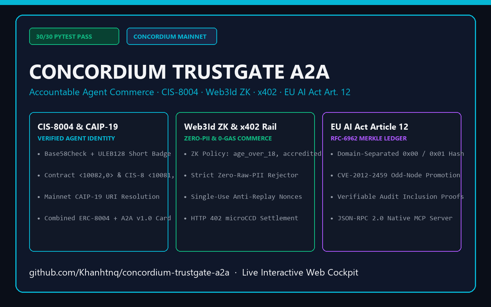

# Concordium TrustGate A2A



Accountable Autonomous Agent Commerce and Compliance Gateway uniting Concordium CIS-8004, CIS-8, Web3Id Zero-Knowledge Policy Gates, x402 Sponsored Micropayments, and EU AI Act Article 12 Merkle Audit Consensus.

Developed for Encode Club - Concordium Trusted Agents Hackathon (Challenge: Make your Agents Accountable with Concordium).

- **Live Interactive Web Cockpit**: [https://khanhtnq.github.io/concordium-trustgate-a2a/](https://khanhtnq.github.io/concordium-trustgate-a2a/)
- **1080p Demo Video (`40s`, `30fps`)**: [`assets/demo_1080p.mp4`](assets/demo_1080p.mp4) | [Hosted MP4](https://khanhtnq.github.io/concordium-trustgate-a2a/demo_1080p.mp4)
- **Test Verification**: `30/30` passing unit & adversarial tests (`pytest` / `unittest`), `0` `ruff` warnings.

---

## 1. Architectural Overview

```
 [ External Client / Agent ]
              |
              v (A2A / MCP Request)
 +-----------------------------------------------------------------------+
 |                    CONCORDIUM TRUSTGATE A2A                           |
 |                                                                       |
 |  1. CIS-8004 "Verified by Concordium" Badge Codec & CAIP-19 Resolver  |
 |     - Decodes Base58Check short badge <10082, 0>                      |
 |     - Resolves ccd:9dd9ca4d19e9393877d2c44b70f89acb/cis-2:<badge>    |
 |                                                                       |
 |  2. Combined ERC-8004 + A2A v1.0 Agent Card Verifier                  |
 |     - On-chain SHA-256 metadata integrity verification                |
 |     - CIS-8 cross-chain external key registry binding                 |
 |                                                                       |
 |  3. Concordium Web3Id Zero-Knowledge Attribute Policy Gate            |
 |     - Evaluates age_over_18, jurisdiction_allowed, accredited         |
 |     - Anti-replay nonce window, zero raw PII disclosure               |
 |                                                                       |
 |  4. Concordium x402 Sponsored Micropayment Rail                       |
 |     - HTTP 402 challenge-response for microCCD tokens                 |
 |     - Concordium Sponsor Relayer gas sponsorship (user_gas_fee == 0)  |
 |                                                                       |
 |  5. EU AI Act Article 12 Accountable Execution Ledger                 |
 |     - RFC-6962 compliant Merkle Tree (CVE-2012-2459 immune)           |
 |     - Cryptographic inclusion proofs for regulatory audit             |
 +-----------------------------------------------------------------------+
              |
              v
 [ Verifiable Accountable Settlement & Audit Certificate ]
```

---

## 2. Five Core Vectors

### Vector 1: CIS-8004 Badge Codec & CAIP-19 Resolver
- Implements Concordium's short badge format:
  `tag_0x02 || ULEB128(index) || ULEB128(subindex) || u64_little_endian || 4_byte_double_sha256_checksum`
- Canonical CAIP-19 format for Mainnet (`ccd:9dd9ca4d19e9393877d2c44b70f89acb`) and Testnet (`ccd:4221332d34e1694168c2a0c0b3fd0f27`).
- Bound to official Mainnet contracts: CIS-8004 Agent Registry `<10082, 0>` and CIS-8 Key Registry `<10081, 0>`.

### Vector 2: Combined ERC-8004 + A2A v1.0 Agent Card & CIS-8 Binding
- Combined specification schema: name, description, semver version, services (`A2A`, `MCP`), `x402Support: True`, `active: True`.
- Extensions block containing short badge, CAIP-19 URI, and owner CAIP-10 address.
- On-chain state verifier enforcing active status and exact SHA-256 metadata hash match.
- CIS-8 raw hex binding verification strictly without prefix per Concordium specification.

### Vector 3: Web3Id Zero-Knowledge Attribute Policy Gate
- Privacy-preserving attribute verification for sensitive agent operations (`age_over_18`, `jurisdiction_allowed`, `accredited_operator`).
- Single-use challenge nonces preventing replay attacks.
- Enforced zero raw PII policy: presence of DOB, passport, or SSN in proof payload triggers rejection.

### Vector 4: x402 Sponsored PLT Micropayment Protocol
- Complete HTTP 402 challenge-response flow for Concordium Protocol-Level Tokens (microCCD).
- Replay-protected settlement against unique transaction hashes.
- Invariant: `user_gas_fee == 0`, guaranteed by Concordium sponsor relayer mechanism.

### Vector 5: EU AI Act Article 12 Accountable Ledger
- Record-keeping engine fulfilling EU AI Act Article 12 traceability obligations for high-risk and autonomous AI deployments.
- RFC-6962 compliant Merkle tree with domain separation: `\x00` leaf prefix, `\x01` internal node prefix.
- Direct promotion of unpaired odd leaves, eliminating CVE-2012-2459 self-duplication ambiguity.
- Cryptographic inclusion proof generation (`get_proof`) and verification (`verify_proof`).

---

## 3. Quickstart

### Installation & Test Suite
```bash
python -m unittest discover -s tests -v
python -m ruff check .
```

### CLI Execution
```bash
# Run complete 5-vector end-to-end accountable transaction demo
python -m ccd_trustgate.cli demo-flow

# Machine-readable JSON output
python -m ccd_trustgate.cli demo-flow --json-out

# List registered Model Context Protocol (MCP) tools
python -m ccd_trustgate.cli mcp-tools

# Decode and inspect CIS-8004 badge
python -m ccd_trustgate.cli verify-badge Mf22pHksNPFr1kgybTNRr
```

### Web Cockpit
Open `docs/index.html` directly in any modern browser or run:
```bash
python -m http.server 8080 --directory docs
```
Navigate to `http://localhost:8080` to inspect the visual 5-vector verification cockpit with interactive attack simulation toggles.

---

## 4. Path to Production

1. **Testnet to Mainnet Migration**: The gateway targets Mainnet CIS-8004 contract `<10082, 0>` and CIS-8 contract `<10081, 0>`. Switching between environments requires updating the genesis hash parameter.
2. **Sponsor Relayer Integration**: Relayer accounts cover network transaction fees for micropayments, enabling seamless consumer onboarding without requiring users to hold CCD for gas.
3. **Hosted MCP Federation**: Compatible with Concordium's official hosted registry endpoints for automated tool discovery.
